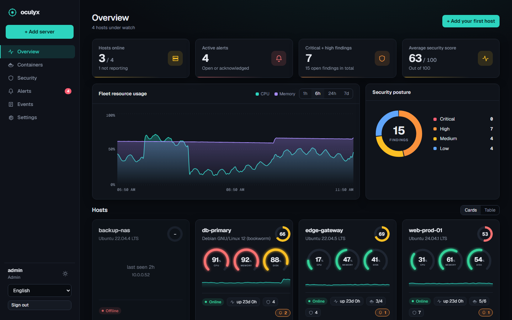
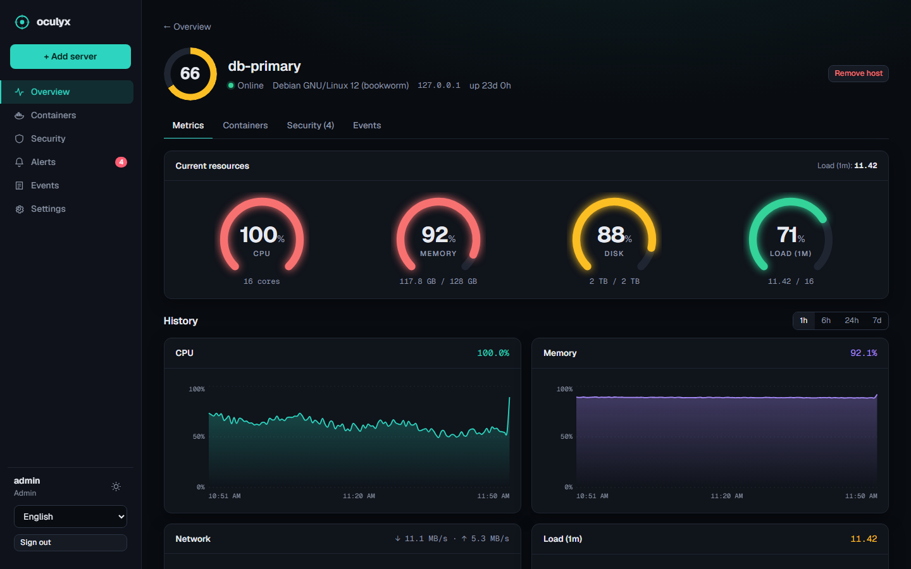
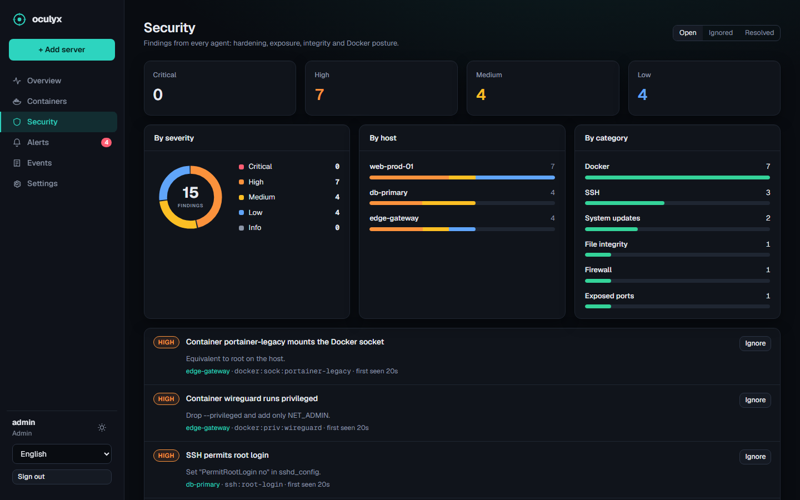
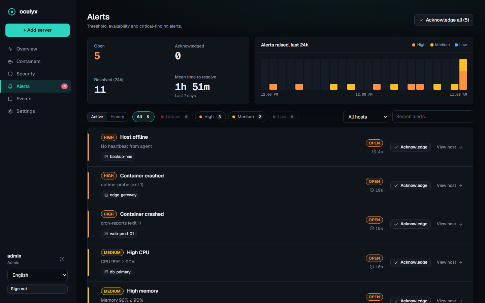
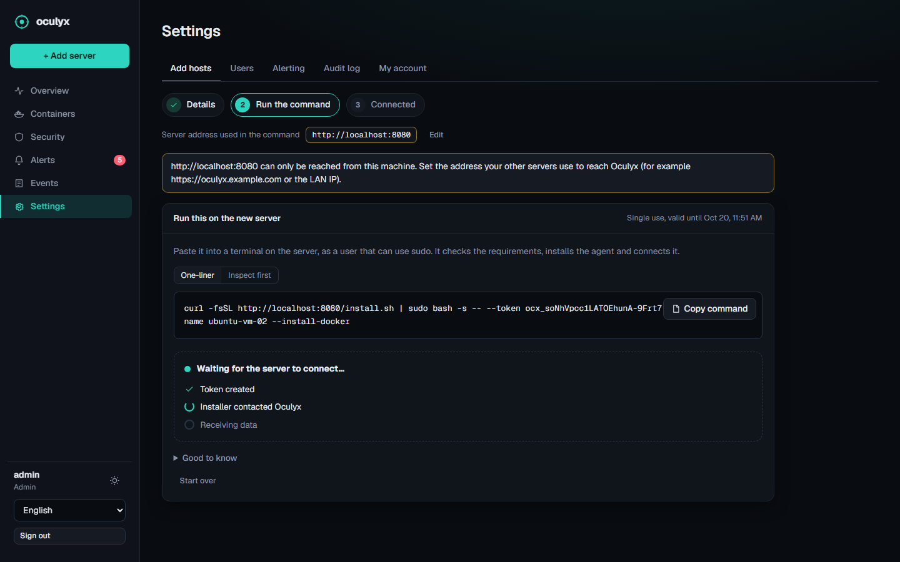
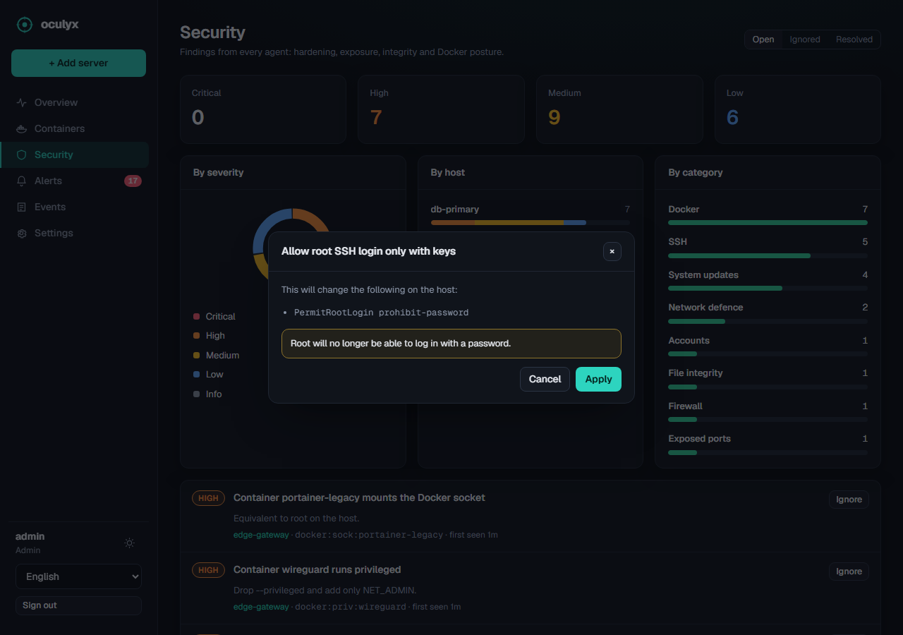
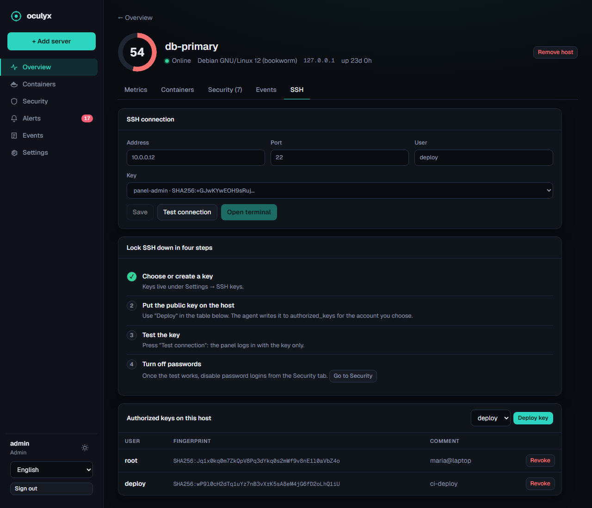

<h1 align="center">Oculyx</h1>

<p align="center">
  Self-hosted server monitoring, security checks and Docker management for your Linux fleet.<br>
  One lightweight server, many agents that connect <b>outbound</b>. Runs happily in a Proxmox LXC.
</p>

<p align="center">
  <a href="https://github.com/jantorras/oculyx/actions/workflows/ci.yml"></a>
  <a href="https://github.com/jantorras/oculyx/releases/latest"></a>
  <a href="LICENSE"></a>
  
</p>

<p align="center">
  <a href="#install-the-server"><b>Install</b></a> &nbsp;·&nbsp;
  <a href="#proxmox-lxc-recommended">Proxmox LXC</a> &nbsp;·&nbsp;
  <a href="#docker-compose">Docker</a> &nbsp;·&nbsp;
  <a href="#use-your-own-domain-cloudflare-tunnel">Domain</a> &nbsp;·&nbsp;
  <a href="#add-servers-to-monitor">Add servers</a> &nbsp;·&nbsp;
  <a href="#try-it-without-installing-anything">Demo</a>
</p>

<p align="center"></p>

## What you get

- **Monitoring** — CPU, memory, disk, network and load per host, with history up to 7 days, threshold and offline alerts, webhook / Telegram notifications.
- **Docker** — container inventory with live CPU/memory, logs, and start / stop / restart (opt-in per host).
- **Security** — checks for SSH and account hardening, exposed risky ports, file integrity, pending security updates, Docker posture (privileged, `docker.sock`, host network, root user, unpinned tags) and a security score per host. Each hardening finding can be **fixed from the panel** (see below).
- **Intrusion detection** — who signs in and from where (new address, root, off-hours, login right after a brute-force burst), suspicious `sudo` commands, new accounts, privileged-group and SSH-key changes, new cron/systemd/PAM persistence, new SUID files, reverse shells, processes running from `/tmp`, crypto-miners, unknown kernel modules. Every rule can be switched off or re-rated under *Settings → Detection*.
- **SSH from the panel** — create or import SSH keys, put them on a host, test the login and open a **terminal in the browser**. Private keys are encrypted at rest, host keys are pinned, every session is audited.
- **Windows agent** — metrics, Docker Desktop, and Windows-specific checks: Defender and firewall state, SMBv1, RDP without NLA, exposed RDP/SMB/WinRM/SQL ports, failed and RDP logons from the Security event log (brute-force detection), local Administrators changes, `hosts` file integrity, pending reboot, stale updates, accounts without password.
- **Teams** — admin / operator / viewer roles, audit log, login rate limiting. UI in Catalan, Spanish and English, dark and light.
- **Easy to add servers** — one command per host, with a live "waiting for connection" wizard in the UI.

<p align="center">
  
  
  
  
</p>

## Install the server

Three ways, same app. Your data always lives in one place (`/var/lib/oculyx` or a Docker volume), so you can switch later.

| | **Proxmox LXC** | **Docker Compose** | **Debian / Ubuntu** |
|---|---|---|---|
| Best for | homelabs on Proxmox | any machine with Docker | a plain VM or bare metal |
| Effort | one command, guided menu | clone + `up -d` | one command |
| HTTPS | Cloudflare Tunnel from the UI, or any proxy | bundled Caddy, or Cloudflare Tunnel | Cloudflare Tunnel from the UI, or any proxy |
| Update | pick *Update* in the script | `git pull && docker compose up -d --build` | `oculyx-update` |

### Proxmox LXC (recommended)

Open the **Proxmox host shell** (Datacenter → your node → *Shell*) and paste:

```bash
bash -c "$(curl -fsSL https://raw.githubusercontent.com/jantorras/oculyx/main/deploy/proxmox/oculyx-lxc.sh)"
```

An interactive menu opens, like the community helper scripts:

```
┌──────────── Oculyx LXC installer ────────────┐
│  1  Install with default settings (recommended)
│  2  Install with advanced settings
│  3  Update an existing Oculyx container
│  4  Cancel
└───────────────────────────────────────────────┘
```

- **Default settings**: unprivileged Debian 12 container, 2 cores, 1 GB RAM, 8 GB disk, DHCP on `vmbr0`, auto-start on boot. You only confirm.
- **Advanced settings**: step by step, container ID, hostname, CPU, RAM, disk, storage, bridge, DHCP or static IP, VLAN and web port.
- **Update**: lists the Oculyx containers on the node and upgrades the one you pick. The database is backed up first.

When it finishes it prints the URL and the first admin password (shown once). Open the URL, sign in, change the password under *Settings → My account*.

Unattended / scripted use skips the menu:

```bash
bash oculyx-lxc.sh --ip 192.168.1.50/24 --gw 192.168.1.1 --ctid 120 --storage local-zfs --yes
bash oculyx-lxc.sh --update 120
```

Run `bash oculyx-lxc.sh --help` for every option. Back the container up with `vzdump <CTID>`.

### Docker Compose

Needs Docker with the Compose plugin. Nothing else.

```bash
git clone https://github.com/jantorras/oculyx && cd oculyx
docker compose up -d --build
docker compose logs oculyx | grep password      # first admin password, printed once
```

Then open `http://<this-machine>` (port 80, through the bundled Caddy reverse proxy).

- **Your own domain with automatic HTTPS**: point its DNS at the machine and start with `OCULYX_DOMAIN=oculyx.example.com docker compose up -d`.
- **No open ports at all**: keep the default and use *Settings → Domain* to connect a Cloudflare Tunnel (see below). The image ships with `cloudflared`.
- **Your own admin password**: uncomment `OCULYX_ADMIN_PASSWORD` in `docker-compose.yml` before the first start.
- **Update**: `git pull && docker compose up -d --build`. Data is kept in the `oculyx-data` volume.
- **Back up**: `docker run --rm -v oculyx_oculyx-data:/d -v "$PWD":/b alpine tar czf /b/oculyx-backup.tgz -C /d .`

### Any Debian / Ubuntu machine or VM (no Docker)

```bash
curl -fsSL https://raw.githubusercontent.com/jantorras/oculyx/main/deploy/install-server.sh | sudo bash
```

Installs Node.js 24 (official build, checksum verified), a dedicated `oculyx` user and a hardened systemd service. Run `oculyx-update` to upgrade (the database is backed up to `/var/lib/oculyx/backups` first). Settings live in `/etc/oculyx/oculyx.env`. `--uninstall [--purge]` removes it. This is also what the LXC script runs inside the container.

## Use your own domain (Cloudflare Tunnel)

No port forwarding, no reverse proxy, HTTPS included, configured from the web UI:

1. In Cloudflare open **Zero Trust → Networks → Tunnels**, create a tunnel (type *Cloudflared*) and copy its token.
2. In that tunnel add a **Public hostname** (your domain) pointing to `HTTP` → `localhost:8080`. `cloudflared` runs inside the Oculyx server itself, so `localhost:8080` is right for every install method.
3. In Oculyx open **Settings → Domain**, paste the token and the domain, press **Save and enable**.

The server runs `cloudflared` itself and shows the tunnel status. Generated agent install commands switch to the new domain automatically.

## Harden servers and detect intruders

<p align="center">
  
  
</p>

**One-click fixes.** Findings marked *Apply fix* show exactly what will change, ask for confirmation when it could lock you out, and apply it on the host: SSH settings (`MaxAuthTries`, root login, passwords, modern algorithms, idle timeouts), `ufw` with default deny and your listening ports allowed, `fail2ban`, automatic security updates, kernel `sysctl` hardening, `su` restricted to a group, `hidepid` on `/proc`, file permissions. SSH changes are validated with `sshd -t`, checked with `sshd -T` and rolled back automatically if anything is off; "Undo SSH changes" removes them. Inspired by [How To Secure A Linux Server](https://github.com/imthenachoman/How-To-Secure-A-Linux-Server) (CC BY-SA 4.0).

> Fixes need an agent installed in **native mode with `--allow-actions`** (it runs as root). Docker-mode agents mount the host read-only and can only report. The agent never runs arbitrary commands from the server: every fix is a named, parameter-checked operation.

**Lock SSH down in four steps** (host → *SSH* tab): create a key under *Settings → SSH keys*, deploy it to an account, press *Test connection* (the panel logs in with the key only), then turn passwords off from the Security tab. The panel refuses to disable passwords if no account has a key.

**Detection** works from the auth log or the journal (Debian 12 has no `auth.log`), `/proc`, and file baselines kept by the agent. Keys you deploy from the panel are not reported as intruders; keys added behind its back are. The first 24 hours of logins only teach the panel what is normal.

## Add servers to monitor

In the web UI click **Add server**, name it, and paste the command on the host:

```bash
curl -fsSL https://YOUR-OCULYX/install.sh | $(command -v sudo) bash -s -- --token ocx_... --name web-02
```

`$(command -v sudo)` makes the same line work as root (a Proxmox shell has no `sudo`) and as a sudo user on Ubuntu/Debian.

| Mode | Flag | Use it for |
|---|---|---|
| Docker container | *(default)*, `--install-docker` to install Docker | hosts that already run Docker |
| System service | `--native` | Proxmox hosts, LXC containers, anything without Docker |

### Windows (10/11, Server 2016+)

Open **PowerShell as Administrator** on the machine and paste the command the UI shows:

```powershell
[Net.ServicePointManager]::SecurityProtocol=[Net.SecurityProtocolType]::Tls12; & ([scriptblock]::Create((irm 'https://YOUR-OCULYX/install.ps1'))) -Token 'ocx_...' -Name 'my-pc'
```

It downloads a portable, checksum-verified Node.js and the agent from your server, and runs the agent as a scheduled task under SYSTEM (`ProgramData\Oculyx`, locked to Administrators). Same script upgrades it; `-Uninstall [-Purge]` removes it; `-AllowActions` enables Docker Desktop container control.

### Windows app (for PCs: double-click, no PowerShell)

In the web UI choose **Add server -> Windows -> Download OculyxSetup.exe**. The server hands you a ~35 KB installer already stamped with its own address and a single-use token. Double-click it, accept the Windows prompt, done: it installs the agent and adds a **tray icon** (green = connected, with *Open dashboard* and *Uninstall*).

- Unattended rollout (GPO / Intune / scripts): `OculyxSetup.exe --silent` (exit code 0 = ok, log in `%TEMP%\oculyx-setup.log`).
- The file is **not code-signed**, so Windows SmartScreen may warn the first time (*More info -> Run anyway*). Sign it with your own certificate if you roll it out widely.
- It is compiled in CI with the C# compiler that ships with Windows (no SDK); source in `windows/OculyxSetup`.

### How the Linux installer works

The installer checks requirements, downloads the agent from **your** server, starts it and confirms the connection. Re-running upgrades it; `--uninstall [--purge]` removes it; `--allow-actions` enables start/stop/restart of containers from the UI. Tokens are single-use and expire after 24 hours. Prefer to read it first? `curl -fsSL https://YOUR-OCULYX/install.sh | less`.

Set the address agents should use under *Settings → Add hosts → Edit* when it differs from the one in your browser (reverse proxy, different DNS name).

## HTTPS with your own proxy

Prefer your own reverse proxy over the Cloudflare Tunnel? Oculyx speaks plain HTTP; put TLS in front of it and set `OCULYX_TRUST_PROXY=1` in `/etc/oculyx/oculyx.env`. A minimal Caddy example:

```
oculyx.example.com {
    reverse_proxy 192.168.1.50:8080
}
```

Agents use WebSockets over the same address, so make sure your proxy allows them (Caddy, nginx-proxy-manager and Traefik do by default).

## Try it without installing anything

Needs Node.js 24+:

```bash
git clone https://github.com/jantorras/oculyx && cd oculyx
npm install && npm run build:web
npm run demo        # http://localhost:8080   admin / oculyx-demo-1234
```

The demo runs the real server with simulated hosts that speak the real agent protocol, plus a day of history.

## How it works

```
 [agent]  ──outbound WebSocket──▶  [server]  ◀──  web UI
  metrics, docker, security          API · SQLite · alert engine
```

- `server/` Fastify + SQLite (Node's built-in `node:sqlite`), no native dependencies.
- `agent/` collectors read `/proc`, the Docker socket and a few security-relevant files; it only ever dials out.
- `web/` React + Vite, no UI framework.
- Node 24 runs the TypeScript directly, so there is no build step for the server or agent.

## Security notes

- Agents are **read-only** unless started with `--allow-actions`. Remember that access to `docker.sock` is root-equivalent on that host.
- Run the server behind HTTPS. Agent credentials are per-agent secrets, stored hashed on the server; enrollment tokens are single-use and short-lived.
- The agent installer and bundle are served unauthenticated on purpose (a fresh machine fetches them with `curl`); they contain no secrets.
- Found a vulnerability? Please open a private security advisory on GitHub instead of a public issue.

## Status and roadmap

Early (v0.x). Not done yet: 2FA, CVE scanning for packages and images, a full CIS benchmark audit, Lynis/AIDE integration, automatic IP blocking, container terminal, PostgreSQL backend for very large fleets, tests beyond the end-to-end install check in CI.

## License

[MIT](LICENSE)
